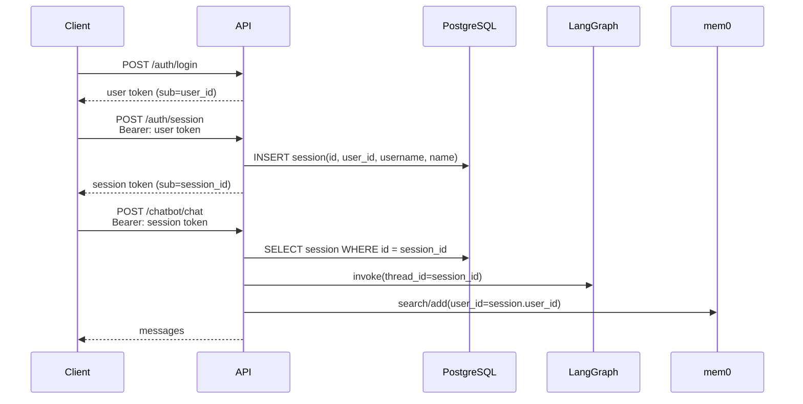

# `/auth/session` 设计说明

> 适用代码：当前 `master`。行号以当前提交为准。
>
> 相关文档：[authentication.md](authentication.md)、[long-term-memory-deep-dive.md](long-term-memory-deep-dive.md)。

## 1. 一句话总结

`/auth/session` 不是为了“登录”，而是为了**把“用户身份”和“一次具体对话”分开**：

- `register` / `login` 发的是**用户级 token**，回答“你是谁”。
- `/auth/session` 创建一条会话记录，并返回**会话级 token**，回答“这次对话是哪一次”。
- `session_id` 同时是 LangGraph 的 `thread_id`，负责隔离短期对话历史。
- `user_id` 用于 mem0 长期记忆，同一个用户的多个会话共享长期记忆。

```text
register / login
      │
      ▼
  user token（证明你是谁）
      │
      ▼
POST /auth/session
      │
      ├─ 创建 session 记录（user_id, username, name, created_at）
      └─ 返回 session token（绑定一个 session_id）
                    │
                    ▼
             /chatbot/chat
                    │
                    ├─ session_id → LangGraph thread_id（短期历史/checkpoint）
                    └─ user_id    → mem0 长期记忆（跨会话共享）
```

---

## 2. 整体流程



---

## 3. 两层 token

| Token | 签发接口 | `sub` | 使用的依赖 | 用途 |
|---|---|---|---|---|
| 用户级 token | `/auth/register`、`/auth/login` | `user_id` | `get_current_user` | 创建会话、列出会话 |
| 会话级 token | `/auth/session` | `session_id` | `get_current_session` | 聊天、读消息、重命名/删除当前会话 |

两种 token 都是 HS256 JWT，默认有效期由 `JWT_ACCESS_TOKEN_EXPIRE_DAYS` 控制（默认 30 天）。

> 注意：两者结构相同，没有显式的 `typ` claim；区别主要靠 `sub` 的内容和接口使用的依赖来保证。

---

## 4. 设计目的

### 4.1 身份与对话解耦

登录只解决“用户是谁”，不创建任何聊天资源。会话是聊天业务资源，由 `/auth/session` 显式创建。

这样做的直接效果：

- 登录接口保持纯粹，不产生空会话。
- 认证逻辑和聊天业务解耦。
- 前端如果希望“登录后直接开新对话”，可以在登录成功后自己调用一次 `/auth/session`。

### 4.2 支持一个用户多个会话

`session` 表每行代表一个独立对话：

```text
session
  id        uuid        ← 会话 id，也是 LangGraph thread_id
  user_id   int         ← 归属用户
  name      str         ← 会话标题，首次聊天后自动生成
  username  str         ← 创建时从 user 复制，用于 system prompt 个性化
  created_at
```

对应能力：

- `POST /auth/session` 新建会话
- `GET /auth/sessions` 列出当前用户的所有会话
- `PATCH /auth/session/{id}/name` 重命名
- `DELETE /auth/session/{id}` 删除

这是“多对话 / 侧边栏”功能的基础。

### 4.3 会话隔离：`session_id` 就是 LangGraph 的 `thread_id`

聊天接口把 `session.id` 直接传给 agent：

```python
# app/api/v1/chatbot.py:65
result = await agent.get_response(
    chat_request.messages,
    session.id,
    user_id=str(session.user_id),
    username=session.username,
)
```

`get_response` 里：

```python
# app/core/langgraph/graph.py:299
"configurable": {"thread_id": session_id}
```

因此：

- **短期对话历史**按 `session_id` 隔离，存在 LangGraph checkpoint 表里。
- 不同 session 互不串历史。
- 同一个 session 的多轮对话通过 `thread_id` 恢复上下文。

### 4.4 长期记忆按 `user_id`，不是 `session_id`

聊天时传给 mem0 的是：

```python
user_id=str(session.user_id)
```

不是 `session.id`。所以：

- **短期记忆**：session 级，LangGraph checkpoint。
- **长期记忆**：user 级，mem0 + pgvector。

效果：

- 同一个用户的多个会话共享长期记忆。
- 不同用户之间严格隔离。
- 删除一个会话不会删除该用户的长期记忆。

### 4.5 会话名称与个性化

`/auth/session` 创建时：

```python
# app/api/v1/auth.py:261
session = await db_service.create_session(
    session_id, user.id, username=user.username
)
```

- `username` 从用户表复制到 session，聊天时不需要再查一次 user 表。
- `name` 初始为空，第一次聊天时 `maybe_name_session()` 会原子抢占并生成标题（`app/services/session_naming.py:77`）。
- `GET /auth/sessions` 返回名称和每个会话的新 token，前端可以还原会话列表。

### 4.6 服务端撤销会话 token

`get_current_session` 不是只验 JWT 签名，还会查数据库：

```python
session = await db_service.get_session(session_id)
if session is None:
    raise HTTPException(status_code=404, detail="Session not found")
```

所以：

- JWT 还没过期也没关系，只要 session 行被删除，session token 立刻失效。
- 这提供了一种**服务端撤销**能力。
- 用户级 token 没有对应的撤销机制，只能等过期。

### 4.7 安全边界

两种 token 不能互相越权：

| 场景 | 结果 |
|---|---|
| 用户 token 调 `/chatbot/chat` | `get_current_session` 把 user id 当 session id 查 → `404 Session not found` |
| 会话 token 调 `/auth/session` | `get_current_user` 尝试 `int(session_id)` → 失败 → `422 Invalid token format` |
| 会话 token 操作别的 session | `session_id != current_session.id` → `403` |

---

## 5. 端点与权限

| 端点 | 依赖 | 权限 |
|---|---|---|
| `POST /auth/session` | `get_current_user` | 用户 token |
| `GET /auth/sessions` | `get_current_user` | 用户 token |
| `PATCH /auth/session/{id}/name` | `get_current_session` | 会话 token，且 id 必须是当前会话 |
| `DELETE /auth/session/{id}` | `get_current_session` | 会话 token，且 id 必须是当前会话 |
| `POST /chatbot/chat` | `get_current_session` | 会话 token |
| `POST /chatbot/chat/stream` | `get_current_session` | 会话 token |
| `GET /chatbot/messages` | `get_current_session` | 会话 token |
| `DELETE /chatbot/messages` | `get_current_session` | 会话 token |

---

## 6. 数据放在哪里

| 数据 | Scope | 存储位置 |
|---|---|---|
| 会话元数据（id/user_id/name/username/created_at） | 每个会话 | `session` 表 |
| 聊天消息 / LangGraph checkpoint | 每个会话（`thread_id=session_id`） | `checkpoints`、`checkpoint_blobs`、`checkpoint_writes` |
| 长期记忆 | 每个用户 | `longterm_memory`（pgvector） |
| 记忆历史 | 本机 | `~/.mem0/history.db`（SQLite） |

---

## 7. 为什么登录不自动创建会话

如果登录时自动创建会话，会带来：

- 每次登录产生一个空会话，污染会话列表。
- 认证和聊天业务耦合。
- 用户可能只想查看会话列表，并不想开新对话。

如果产品希望“登录后进入新对话”，推荐由前端在登录成功后调用一次 `POST /auth/session`，后端保持两个动作分离。

---

## 8. 设计取舍与当前实现的注意点

### 8.1 `POST /auth/session` 没有限流

`register` 和 `login` 有 `@limiter.limit`，但 `/session` 没有。项目规则要求所有路由都限流，这里是一个缺口：已登录用户可以循环创建空会话。

### 8.2 `DELETE /auth/session/{id}` 只删 session 行

`app/services/database.py:156` 只删除 `session` 表记录，不会删除：

- LangGraph checkpoint 表
- mem0 长期记忆

文档 `docs/authentication.md:94` 写的是“删除 session 和聊天历史”，和实际实现不一致。

如果要清空 checkpoint，需要单独调用：

```http
DELETE /api/v1/chatbot/messages
```

它内部会执行 `agent.clear_chat_history(session.id)`。

长期记忆是按 user 维度的，删除单个会话不会删除它；如果要清空某个用户的长期记忆，需要额外的 mem0 管理接口。

### 8.3 没有显式的 token 类型 claim

用户 token 和 session token 都由同一个 `create_access_token()` 生成，结构相同，区别只在 `sub` 和接口依赖。未来可以考虑加：

```json
{"typ": "user"}
{"typ": "session"}
```

让语义更明确，也方便中间件做统一校验。

### 8.4 `GET /auth/sessions` 会为每个会话重新签发 token

方便前端恢复会话，但也意味着用户 token 是一个比较强大的凭据，应按敏感凭证保管。

### 8.5 `Thread` 模型目前没有被业务代码使用

`thread` 表由 Alembic 创建，但聊天实际直接用 `session.id` 作为 LangGraph `thread_id`；这个模型目前更像历史遗留/预留结构。

### 8.6 用户名是创建时复制的

`session.username` 在创建会话时从 `user.username` 复制。如果以后支持修改用户名，已有会话会保留旧值；这是为了聊天时少一次 user 查询而做的反规范化。

### 8.7 Token 有效期与撤销

- 用户 token：默认 30 天，没有刷新/撤销机制。
- 会话 token：默认 30 天；删除 session 行即可服务端撤销。
- `GET /auth/sessions` 会返回每个会话的新 token，可用于恢复前端状态。

---

## 9. 关键代码位置

| 位置 | 内容 |
|---|---|
| `app/api/v1/auth.py:52` | `get_current_user` |
| `app/api/v1/auth.py:103` | `get_current_session` |
| `app/api/v1/auth.py:246` | `POST /auth/session` |
| `app/api/v1/auth.py:280` | `PATCH /auth/session/{id}/name` |
| `app/api/v1/auth.py:316` | `DELETE /auth/session/{id}` |
| `app/api/v1/auth.py:345` | `GET /auth/sessions` |
| `app/api/v1/chatbot.py:35` | `POST /chatbot/chat` |
| `app/api/v1/chatbot.py:77` | `POST /chatbot/chat/stream` |
| `app/api/v1/chatbot.py:148` | `GET /chatbot/messages` |
| `app/api/v1/chatbot.py:174` | `DELETE /chatbot/messages` |
| `app/core/langgraph/graph.py:299` | `thread_id=session_id` |
| `app/core/langgraph/graph.py:449` | `clear_chat_history` |
| `app/models/session.py:19` | `Session` 模型 |
| `app/services/database.py:134` | `create_session` |
| `app/services/database.py:156` | `delete_session` |
| `app/services/database.py:188` | `get_user_sessions` |
| `app/services/session_naming.py:77` | `maybe_name_session` |
| `app/utils/auth.py:22` | `create_access_token` |
| `app/core/config.py:181` | JWT 过期天数 |
| `docs/authentication.md:23` | 两层 token 的设计说明 |

---

## 10. 结论

`/auth/session` 的设计目的可以概括为：

> 把“用户是谁”和“这次对话是哪一次”解耦。  
> 用户 token 管身份和会话管理，session token 管具体对话；  
> `session_id` 负责 LangGraph 短期历史，`user_id` 负责 mem0 长期记忆。
