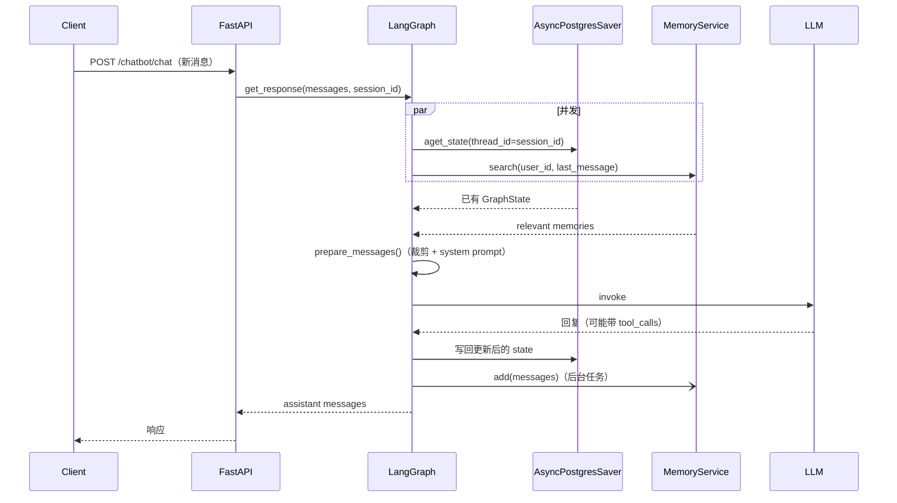

# GraphState 设计说明（状态、上下文窗口与长期记忆）

> 适用代码：当前 `master`。行号以当前提交为准。
>
> 相关文档：[architecture.md](architecture.md)、[memory.md](memory.md)、[long-term-memory-deep-dive.md](long-term-memory-deep-dive.md)、[observability.md](observability.md)。

## 1. 一句话总结

`GraphState` 是一次会话线程的**唯一状态容器**，只回答“上下文里存什么”，不回答“这次给模型看多少”：

- `messages` + `add_messages`：短期对话历史，跨请求累积。
- `AsyncPostgresSaver` 按 `thread_id = session_id` 持久化整个 state。
- `long_term_memory`：每次请求由 mem0 检索后覆盖写入，渲染进 system prompt。
- 真正的上下文裁剪发生在 `prepare_messages()`，只影响单次 LLM 调用，不改动 state。

```text
请求
  │
  ├─ aget_state(thread_id=session_id) ──► 恢复 GraphState
  └─ mem0.search(user_id, query)     ──► long_term_memory
                    │
                    ▼
        GraphState(messages + long_term_memory)
                    │
            prepare_messages()
         （裁剪窗口 + 拼接 system prompt）
                    │
                    ▼
                   LLM
```

---

## 2. 字段定义

```python
# app/schemas/graph.py:12
class GraphState(BaseModel):
    messages: Annotated[list, add_messages] = Field(default_factory=list)
    long_term_memory: str = Field(default="")
```

| 字段 | 类型 | reducer | 作用域 | 生命周期 |
| --- | --- | --- | --- | --- |
| `messages` | `list` | `add_messages` | 单个会话（thread） | 检查点持久化，append-only |
| `long_term_memory` | `str` | 无（LastValue） | 单次请求 | 每次请求被新检索结果覆盖 |

---

## 3. `messages`：短期对话历史

### 3.1 `add_messages` reducer

`add_messages` 让节点返回的消息与已有历史**合并**而不是替换：

- 无 `id` 的消息：追加。
- 有相同 `id` 的消息：原地更新。
- `RemoveMessage`：删除指定消息。

因此节点只需返回增量：

```python
# app/core/langgraph/graph.py:176
return Command(update={"messages": [response_message]}, goto=goto)
```

### 3.2 检查点与恢复

- 图用 `AsyncPostgresSaver` 编译（`app/core/langgraph/graph.py:236`）。
- 每次调用把 `thread_id = session_id` 放进 config（`graph.py:298-300`、`graph.py:368-369`），LangGraph 据此读写对应检查点。
- 请求开始时先 `aget_state(config)` 判断是否有被中断的图（`graph.py:312-322`）；有则用 `Command(resume=...)` 继续，没有才注入新的输入。
- `ask_human` 等中断场景依赖这套机制：state 里保存了完整的图执行位置。

### 3.3 输入合并的注意事项

`ChatRequest.messages` 的消息没有 `id` 字段（`app/schemas/chat.py:20`）。`add_messages` 会给每条无 `id` 的输入消息生成新的 UUID 后追加。

这意味着：**如果客户端每次都提交完整历史，检查点里会出现重复消息**。对接时应当：

- 只发送本轮新增消息，让检查点负责保存历史；或
- 在 API schema 中增加稳定的消息 `id`，让 reducer 按 `id` 去重更新。

---

## 4. `long_term_memory`：长期记忆注入

`long_term_memory` 是普通字段（无 reducer），每次请求整体覆盖：

1. **检索**：`memory_service.search(user_id, messages[-1].content)` 与 `aget_state` 并发执行（`app/core/langgraph/graph.py:312-315`）。
2. **注入**：检索结果作为 `long_term_memory` 传入图输入（`graph.py:326`），由 `load_system_prompt()` 渲染进 system prompt（`app/core/prompts/system.md:12`）。
3. **写回**：响应完成后通过 `asyncio.create_task(memory_service.add(...))` 异步写入 mem0（`graph.py:338`），不阻塞回复。
4. **匿名会话**：`user_id` 为空时 `search`/`add` 直接跳过（`app/services/memory.py:83-84`、`111-112`）。

这里只注入一段检索出的文本，不保存历史记忆列表。记忆的抽取、去重、embedding 由 mem0 负责，详见 [long-term-memory-deep-dive.md](long-term-memory-deep-dive.md)。

---

## 5. 上下文窗口：真正的裁剪点

`prepare_messages()`（`app/utils/graph.py:105`）在每次调用 LLM 前执行：

```python
# app/utils/graph.py:116
trim_messages(
    messages,
    strategy="last",
    token_counter=_count_tokens_tiktoken,
    max_tokens=settings.MAX_TOKENS,
    start_on="human",
    include_system=False,
    allow_partial=False,
)
```

流程：

1. 用本地 `tiktoken` 计数（`app/utils/graph.py:18`），不发起 API 调用。
2. 从最新消息往前保留，直到达到 `MAX_TOKENS`；窗口从 human 消息开始，避免截出半个工具调用。
3. 裁剪完成后才拼接 system prompt —— system prompt 不占用裁剪预算（`app/utils/graph.py:138`）。
4. 遇到无法识别的内容块（如 GPT-5 的 reasoning block）时跳过裁剪并告警，而不是报错（`app/utils/graph.py:125-136`）。

两个直接结论：

- **裁剪只影响发给 LLM 的内容，state 仍是全量历史。**
- `MAX_TOKENS` 同时也是模型输出上限（`app/core/config.py:160`、`app/services/llm/registry.py:19,68`）。调大以容纳更长对话，会同时提高每次回复的 token 预算和成本。

---

## 6. 一次请求的状态流转



带工具调用时，`chat → tool_call → chat` 的多轮循环都在同一次 state 上累积；检查点在每步之后写入。

---

## 7. 设计边界与已知限制

### 7.1 职责边界

| 关注点 | 负责组件 | 是否属于 GraphState |
| --- | --- | --- |
| 会话内历史 | `GraphState.messages` + 检查点 | 是 |
| 单次请求发给模型的内容 | `prepare_messages()` | 否 |
| 跨会话用户记忆 | mem0 + pgvector | 否（只注入检索结果） |
| 日志上下文（`user_id`/`session_id`） | structlog `ContextVar` | 否 |

### 7.2 已知限制

- **检查点无上限增长**：裁剪只在调用 LLM 时发生，state 里的历史只增不减。超长会话会持续占用 PostgreSQL。
- **消息无稳定 ID**：客户端重发完整历史会产生重复消息（见 3.3）。
- **输入与输出共享 `MAX_TOKENS`**：两个预算无法独立调整。
- **`long_term_memory` 不累积**：每次请求只保留本次检索结果，适合注入但不适合保存对话摘要。

### 7.3 可能的演进方向

- 在 state 中增加摘要/裁剪节点，用 `RemoveMessage` 控制检查点体积。
- 为消息引入稳定 ID，或在 API 层只接收增量消息。
- 拆分 `MAX_TOKENS` 为输入窗口预算与输出上限两个配置。

---

## 8. 代码索引

| 主题 | 位置 |
| --- | --- |
| 状态定义 | `app/schemas/graph.py:12` |
| 图构建与检查点 | `app/core/langgraph/graph.py:214-262` |
| 请求入口与状态恢复 | `app/core/langgraph/graph.py:278-347` |
| 流式入口 | `app/core/langgraph/graph.py:349-` |
| 上下文裁剪 | `app/utils/graph.py:105-138` |
| 长期记忆服务 | `app/services/memory.py:74-118` |
| system prompt 模板 | `app/core/prompts/system.md:12` |
| `MAX_TOKENS` 配置 | `app/core/config.py:160` |
