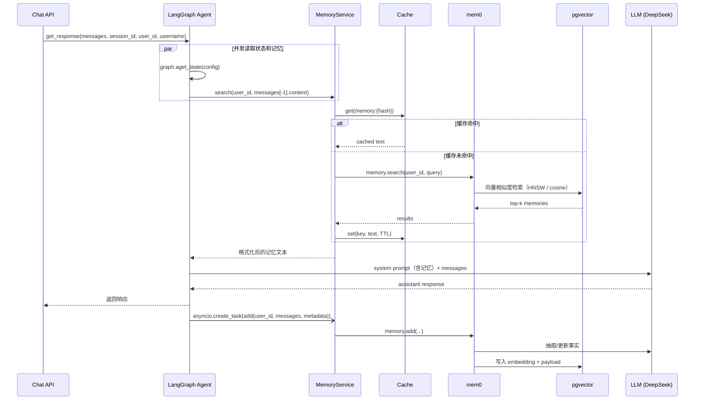

# 长期记忆实现详解（mem0 + pgvector）

> 适用代码：当前 `master`。行号以当前提交为准。
>
> 相关文档：[docs/memory.md](memory.md)（上游设计概览）、[docs/local-run-deepseek-siliconflow.md](local-run-deepseek-siliconflow.md)（本机启动手册）。

## 1. 一句话总结

项目用 **mem0 + pgvector** 实现按用户隔离的语义长期记忆：

- **请求前**：用最后一条用户消息做向量检索，把命中结果注入 system prompt。
- **响应后**：把本轮消息交给 mem0，由 memory LLM 抽取事实、embedding 后写入 pgvector。
- **缓存**：检索结果可走 Valkey/Redis 或进程内 TTL 缓存。

应用层不直接操作向量库，只负责 `search` / `add` / 缓存 / prompt 注入；向量检索、事实抽取、去重更新都由 mem0 完成。

---

## 2. 组件

| 组件 | 位置 | 作用 |
|---|---|---|
| `MemoryService` | `app/services/memory.py` | mem0 配置、search/add、缓存 |
| mem0 `AsyncMemory` | 依赖 `mem0ai` | 事实抽取、embedding、向量存储 |
| pgvector | PostgreSQL 扩展 | 存储向量和 payload |
| `OpenAICompatibleEmbedding` | `app/services/embeddings.py` | 兼容硅基等不接受 `dimensions` 的 embedder |
| `CacheService` | `app/core/cache.py` | 检索结果缓存 |
| `GraphState.long_term_memory` | `app/schemas/graph.py` | 把检索结果传给 LangGraph |
| `system.md` | `app/core/prompts/system.md` | 把记忆拼进 system prompt |

---

## 3. 请求时序



---

## 4. 检索路径

### 4.1 入口

聊天接口调用 `agent.get_response(...)` / `get_stream_response(...)`：

- 普通聊天：`app/core/langgraph/graph.py:312`
- 流式聊天：`app/core/langgraph/graph.py:383`

两处都用 `asyncio.gather` 并发执行：

```python
state, relevant_memory = await asyncio.gather(
    graph.aget_state(config),
    memory_service.search(user_id, messages[-1].content),
)
```

并发执行是为了节省 200–500ms。

注意：**检索 query 只取最后一条消息** `messages[-1].content`，不是整段对话。

### 4.2 `MemoryService.search()`

实现在 `app/services/memory.py:74`。

1. `user_id` 为空 → 直接返回空字符串。
   - 匿名会话不写不查，避免所有匿名用户共享一个记忆分区。
2. 计算缓存 key 并查缓存。
3. 缓存未命中 → 调用 mem0：

   ```python
   results = await memory.search(user_id=str(user_id), query=query)
   ```

4. 格式化结果：

   ```python
   result = "\n".join([f"* {r['memory']}" for r in results["results"]])
   ```

5. 只有**非空成功结果**才写缓存。
6. 任何异常都会记录 `failed_to_get_relevant_memory`，返回空字符串，聊天继续。

### 4.3 注入 system prompt

检索结果作为 `GraphState.long_term_memory` 传入图：

- 状态字段：`app/schemas/graph.py:18`
- 注入点：`app/core/langgraph/graph.py:150`

```python
SYSTEM_PROMPT = load_system_prompt(
    username=username,
    long_term_memory=state.long_term_memory,
)
```

模板位置：`app/core/prompts/system.md:11`

```markdown
# What you know about the user
{long_term_memory}
```

没有检索到记忆时，传入 `"No relevant memory found."`，保证占位符始终有值。

---

## 5. 写入路径

### 5.1 触发时机

图执行完成后，把消息转成 OpenAI 格式，并创建后台任务：

```python
openai_msgs = convert_to_openai_messages(response["messages"])
asyncio.create_task(
    memory_service.add(user_id, openai_msgs, config.get("metadata"))
)
```

- 普通聊天：`app/core/langgraph/graph.py:338`
- 流式聊天：`app/core/langgraph/graph.py:415`

`asyncio.create_task` 意味着：

- 响应立即返回，不等待 mem0 完成。
- 写入失败只记录日志，不影响聊天。
- 进程立即退出时，未完成的后台写入可能丢失。

### 5.2 写入内容

- 传入的是该 thread 的**完整消息历史**（`response["messages"]` / `state.values["messages"]`），不只是最后一条用户消息。
- mem0 会根据 hash、LLM 判断来新增、更新或删除记忆，避免简单重复。
- `metadata` 来自 LangGraph 配置，包含 `user_id`、`username`、`session_id`、`environment`、`debug` 等。

### 5.3 中断场景

如果图被 HITL（`ask_human`）中断：

- 普通聊天在 `app/core/langgraph/graph.py:332` 检测到 `state.next` 后提前返回，不会写入记忆。
- 流式聊天在 `app/core/langgraph/graph.py:409` 类似。
- 用户回复后图恢复并完成，才会走正常的后台写入。

---

## 6. 存储结构

mem0 在应用所用的 PostgreSQL 库中自动建表：

```text
longterm_memory
  id      uuid
  vector  vector(1024)
  payload jsonb
  primary key (id)
  hnsw index vector_cosine_ops

mem0migrations
  mem0 自己的 schema 版本表
```

实际 payload 示例：

```json
{
  "data": "Likes green tea",
  "hash": "6be668ba991c1e5e20a76c7bb1ac49aa",
  "user_id": "3",
  "username": "alice",
  "thread_id": "876e3698-...",
  "session_id": "876e3698-...",
  "environment": "development",
  "debug": true,
  "created_at": "2026-10-19T19:37:49.924391-07:00"
}
```

关键点：

- 向量维度由 `LONG_TERM_MEMORY_EMBEDDER_DIMS` 决定，当前是 **1024**。
- 索引是 HNSW + cosine 距离。
- 记忆按 `user_id` 隔离；同一用户的多个 session 共享长期记忆。
- 这些表由 mem0 管理，不由 Alembic 管理；`alembic/env.py:37` 的 `EXCLUDE_TABLES` 明确排除了 `longterm_memory` 和 `mem0migrations`。

---

## 7. 缓存层

实现在 `app/core/cache.py`。

### 7.1 后端选择

`app/core/cache.py:177`：

- 配置了 `VALKEY_HOST` 且安装了 `redis` 可选依赖 → `ValkeyCacheService`。
- 否则 → `InMemoryCacheService`（进程内 TTL 缓存）。

当前项目没有安装 `cache` extra，所以日志里会看到 `redis_not_available`，使用内存缓存。

如果要多实例共享缓存：

```bash
uv sync --extra cache
```

然后设置：

```env
VALKEY_HOST=localhost
VALKEY_PORT=6380
```

### 7.2 key 与 TTL

`cache_key()` 在 `app/core/cache.py:197`：

```python
raw = ":".join(parts)
hashed = hashlib.sha256(raw.encode()).hexdigest()[:16]
return f"{prefix}:{hashed}"
```

`MemoryService.search()` 调用：

```python
key = cache_key("memory", str(user_id), query)
```

所以实际 key 是：

```text
memory:{sha256("user_id:query")[:16]}
```

注意：`docs/memory.md` 里写的是 `memory:{user_id}:{sha256(query)[:16]}`，与当前代码略有出入，以代码为准。

TTL 由 `CACHE_TTL_SECONDS` 控制，默认 60 秒。只缓存成功的非空结果，错误不缓存。

---

## 8. 当前配置（DeepSeek + SiliconFlow）

配置读取位置：`app/core/config.py:165`。

| 变量 | 当前值 | 作用 |
|---|---|---|
| `LONG_TERM_MEMORY_COLLECTION_NAME` | `longterm_memory` | pgvector 表名 |
| `LONG_TERM_MEMORY_MODEL` | `deepseek-chat` | mem0 抽取事实/更新记忆用的 LLM |
| `LONG_TERM_MEMORY_LLM_BASE_URL` | `https://api.deepseek.com/v1` | 记忆 LLM 地址 |
| `LONG_TERM_MEMORY_LLM_API_KEY` | `<DeepSeek key>` | 不写进文档 |
| `LONG_TERM_MEMORY_EMBEDDER_PROVIDER` | `openai_compatible` | 使用省略 `dimensions` 的兼容 embedder |
| `LONG_TERM_MEMORY_EMBEDDER_MODEL` | `BAAI/bge-m3` | 向量模型 |
| `LONG_TERM_MEMORY_EMBEDDER_BASE_URL` | `https://api.siliconflow.cn/v1` | 向量模型地址 |
| `LONG_TERM_MEMORY_EMBEDDER_API_KEY` | `<SiliconFlow key>` | 不写进文档 |
| `LONG_TERM_MEMORY_EMBEDDER_DIMS` | `1024` | 必须与 pgvector 表维度一致 |
| `CACHE_TTL_SECONDS` | `60` | 检索缓存 TTL |
| `VALKEY_HOST` | 空 | 使用进程内缓存 |

代码里的默认值仍是 `gpt-5-nano` / `text-embedding-3-small`，当前 `.env.development` 覆盖成了 DeepSeek + SiliconFlow。

### 8.1 为什么需要自定义 embedder

硅基流动的 embedding API：

- `BAAI/bge-m3` 原生输出 1024 维。
- 不接受 OpenAI SDK 的 `dimensions` 参数。
- mem0 的 `OpenAIEmbedding` 会强制传 `dimensions=self.config.embedding_dims`，导致 400。

因此：

- `app/services/embeddings.py` 提供 `OpenAICompatibleEmbedding`，省略 `dimensions`。
- `app/services/memory.py:17` 在 `LONG_TERM_MEMORY_EMBEDDER_PROVIDER=openai_compatible` 时，把 mem0 的 `openai` provider 替换成这个类。
- pgvector 表仍然按 `LONG_TERM_MEMORY_EMBEDDER_DIMS=1024` 建。

### 8.2 维度变化

如果更换 embedding 模型导致维度变化，需要删除旧表让 mem0 重建：

```sql
DROP TABLE IF EXISTS longterm_memory;
DROP TABLE IF EXISTS mem0migrations;
```

然后重启应用。**这会删除已有长期记忆。**

---

## 9. 启动预热

`app/main.py:65` 的 lifespan：

```python
try:
    await memory_service.initialize()
except Exception as e:
    logger.exception("memory_service_pre_warm_failed", error=str(e))
```

`initialize()` 会创建 `AsyncMemory`、pgvector 连接池并执行 schema 检查，避免第一次检索/写入的冷启动开销。

失败只记录日志，不会阻止应用启动；后续记忆功能会降级（检索返回空、写入失败）。

---

## 10. 文件地图

| 文件 | 内容 |
|---|---|
| `app/services/memory.py:28` | mem0 `AsyncMemory.from_config`：pgvector / LLM / embedder |
| `app/services/memory.py:74` | `search()`：缓存 + mem0 检索 + 格式化 |
| `app/services/memory.py:106` | `add()`：后台写入 + 异常处理 |
| `app/services/embeddings.py` | 硅基兼容 embedder |
| `app/core/langgraph/graph.py:312` | 普通聊天：并发检索 + 注入 + 后台写入 |
| `app/core/langgraph/graph.py:383` | 流式聊天：同上 |
| `app/core/langgraph/graph.py:150` | 把记忆注入 system prompt |
| `app/schemas/graph.py:18` | `GraphState.long_term_memory` |
| `app/core/prompts/system.md:11` | `{long_term_memory}` 占位符 |
| `app/core/cache.py:177` | 缓存后端选择 |
| `app/core/cache.py:197` | 缓存 key 生成 |
| `app/core/config.py:165` | `LONG_TERM_MEMORY_*` 配置 |
| `app/main.py:65` | 启动预热 |
| `alembic/env.py:37` | 排除 mem0 / pgvector 表 |

---

## 11. 验证方法

### 11.1 查看数据库

```bash
docker exec fastapi_langgraph_template-postgres-1 \
  psql -U postgres -d fastapi_agent -c "\d longterm_memory"

docker exec fastapi_langgraph_template-postgres-1 \
  psql -U postgres -d fastapi_agent \
  -c "select payload->>'data', payload->>'user_id' from longterm_memory;"
```

### 11.2 跨会话召回

参考 [local-run-deepseek-siliconflow.md](local-run-deepseek-siliconflow.md) 的 7.8 节：

1. 会话 A 告诉 agent："我叫 Alice，我喜欢绿茶。"
2. 等待约 10 秒，让后台 mem0 写入完成。
3. 同一个用户创建会话 B，问："我喜欢喝什么？"
4. 正常应回答 "绿茶 / green tea"。

### 11.3 日志事件

```text
memory_search_cache_hit
long_term_memory_updated_successfully
failed_to_get_relevant_memory
failed_to_update_long_term_memory
memory_service_initialized
memory_service_pre_warm_failed
```

---

## 12. 设计取舍与注意事项

1. **检索只取最后一条消息**：多轮对话中，如果最后一条不是用户消息，query 可能不是预期内容。
2. **写入是 fire-and-forget**：响应快，但进程退出或崩溃时可能丢写。
3. **写入的是完整 thread 历史**：mem0 自己做 hash/LLM 去重，但每轮都会把历史交给 memory LLM，长对话成本会上升。
4. **记忆按 user_id 隔离**：同一用户跨会话共享；匿名 `user_id=None` 直接跳过。
5. **缓存是近似的**：key 包含完整 query，语义相近但措辞不同的问法会各缓存一份；TTL 默认 60 秒。
6. **多实例部署**：内存缓存只在单进程内有效；多实例应启用 Valkey/Redis。
7. **记忆依赖 LLM**：事实抽取失败时，聊天不受影响，但记忆不会更新。
8. **schema 由 mem0 管理**：Alembic 不管理 `longterm_memory` / `mem0migrations`；维度变更需要手动删表重建。
9. **prompt 注入风险**：记忆内容会进入 system prompt。如果未来支持不可信用户内容或多租户，需要评估提示词注入风险。
10. **文档差异**：`docs/memory.md` 的缓存 key 格式与当前代码不一致，以本文和 `app/core/cache.py` 为准。

---

## 13. mem0 内部机制（mem0ai 1.0.0）

前 12 章讲的是应用层怎么用；这一章拆开 mem0 本身。当前安装版本是 **`mem0ai==1.0.0`**，不同版本内部实现和 prompt 可能变化。

### 13.1 mem0 是什么

mem0 不是简单的“向量库 SDK”，而是一层 **LLM 驱动的记忆管理**：

1. 从对话里抽取事实（LLM）
2. 和已有记忆对比，决定 `ADD` / `UPDATE` / `DELETE` / `NONE`（LLM）
3. 生成 embedding（embedding model）
4. 写入向量库（pgvector）
5. 记录记忆历史（SQLite）
6. 检索时做向量相似度搜索，可选 rerank / graph search

本项目只启用了 **vector store** 路径：

- graph store：未启用
- reranker：未启用
- procedural memory：未使用

### 13.2 初始化

入口是 `AsyncMemory.from_config()`，实现在 `mem0/memory/main.py:1233` 附近。`AsyncMemory.__init__` 会创建：

| 组件 | 工厂 | 项目配置 |
|---|---|---|
| `embedding_model` | `EmbedderFactory` | 硅基 `BAAI/bge-m3`，1024 维 |
| `vector_store` | `VectorStoreFactory` | `pgvector` → `longterm_memory` |
| `llm` | `LlmFactory` | provider `openai`，base URL 指向 DeepSeek |
| `db` | `SQLiteManager` | 默认 `~/.mem0/history.db` |
| `reranker` | `RerankerFactory` | 未配置 → `None` |
| `graph` | `GraphStoreFactory` | 未配置 → `enable_graph=False` |

此外还会创建一个内部 `_telemetry_vector_store`：

- 使用同一套 pgvector 配置，但 collection 名改成 `mem0migrations`
- 这就是数据库里 `mem0migrations` 表的来源
- 它不是业务记忆数据

### 13.3 PGVector 初始化

`mem0/vector_stores/pgvector.py:39`：

1. 用 psycopg3 创建 `ConnectionPool(min_size=1, max_size=5)`。
2. `list_cols()` 查询 `information_schema.tables`。
3. 如果集合不存在，调用 `create_col()`：

```sql
CREATE EXTENSION IF NOT EXISTS vector;

CREATE TABLE IF NOT EXISTS {collection_name} (
    id UUID PRIMARY KEY,
    vector vector({embedding_model_dims}),
    payload JSONB
);

CREATE INDEX IF NOT EXISTS {collection_name}_hnsw_idx
ON {collection_name}
USING hnsw (vector vector_cosine_ops);
```

对应到本项目：

- 表名：`longterm_memory`
- 维度：`1024`
- 索引：HNSW + cosine
- 连接池：1–5 个连接，和应用的 SQLModel 池、LangGraph checkpointer 池完全独立

`mem0migrations` 也是同一套结构，只是 collection 名不同。

### 13.4 `add()` 写入流程

签名在 `mem0/memory/main.py:1323`：

```python
async def add(
    self,
    messages,
    *,
    user_id=None,
    agent_id=None,
    run_id=None,
    metadata=None,
    infer=True,
    memory_type=None,
    prompt=None,
    llm=None,
):
```

项目调用：

```python
await memory.add(messages, user_id=str(user_id), metadata=metadata)
```

所以：

- `infer=True`：走 LLM 事实抽取
- 没有 `agent_id` / `run_id`
- scope 只有 `user_id`

#### 13.4.1 构建 scope 和 metadata

`_build_filters_and_metadata()`（`main.py:87`）：

- 要求 `user_id`、`agent_id`、`run_id` 至少提供一个。
- 把 `user_id` 写入两份东西：
  - 存储 metadata：随记忆写进 payload
  - 查询 filters：检索时用 `payload->>'user_id'` 过滤
- 项目额外传入的 `metadata`（`username`、`session_id`、`environment`、`debug` 等）也会进入 payload。

#### 13.4.2 消息预处理

`add()` 支持 `str` / `dict` / `list[dict]`。项目传的是 `convert_to_openai_messages()` 后的列表。

`parse_messages()`（`mem0/memory/utils.py:32`）只拼接：

- `system`
- `user`
- `assistant`

**tool 消息会被忽略**，不参与事实抽取。

#### 13.4.3 第一次 LLM 调用：抽取事实

mem0 用 `_should_use_agent_memory_extraction()`（`main.py:1302`）决定 prompt：

```python
has_agent_id and has_assistant_messages
```

本项目没有 `agent_id`，所以走 `USER_MEMORY_EXTRACTION_PROMPT`，即**只从用户消息里抽事实**。

调用形式：

```python
llm.generate_response(
    messages=[system_prompt, user_prompt],
    response_format={"type": "json_object"},
)
```

期望返回：

```json
{"facts": ["Name is Alice", "Likes green tea"]}
```

这一步使用 `LONG_TERM_MEMORY_MODEL`，当前是 `deepseek-chat`。

如果没有抽到任何 fact，就跳过后面的更新流程。

#### 13.4.4 每条 fact 检索旧记忆

对每条新 fact：

1. 生成 embedding。
2. 在 pgvector 里按 `user_id` 过滤，检索 **top 5** 条相似旧记忆。
3. 按 id 去重。

目的是让后面的 LLM 判断“新事实是新增、更新还是删除旧记忆”。

#### 13.4.5 第二次 LLM 调用：决定动作

mem0 用 `DEFAULT_UPDATE_MEMORY_PROMPT`（`mem0/configs/prompts.py:175`）把旧记忆和新 facts 交给 LLM，返回类似：

```json
{
  "memory": [
    {"id": "0", "text": "Name is Alice", "event": "ADD"},
    {"id": "1", "text": "Likes green tea", "event": "NONE"}
  ]
}
```

四种事件：

| 事件 | 行为 |
|---|---|
| `ADD` | 新建记忆 |
| `UPDATE` | 更新已有记忆的文本和向量 |
| `DELETE` | 删除旧记忆 |
| `NONE` | 不做修改 |

#### 13.4.6 执行动作

mem0 会并发执行这些动作。

**ADD → `_create_memory`**（`main.py:2024`）：

- 生成 UUID。
- payload 增加：
  - `data`：事实文本
  - `hash`：`md5(data)`
  - `created_at`
  - `user_id`、`username`、`session_id` 等 metadata
- 写入 pgvector。
- 在 SQLite history 里记一条 `ADD`。

**UPDATE → `_update_memory`**（`main.py:2110`）：

- 保留 `created_at`。
- 写入 `updated_at`。
- 保留原有的 `user_id`、`agent_id`、`run_id`、`actor_id`、`role`。
- 重新生成 embedding。
- 更新 vector 和 payload。
- 记一条 `UPDATE` history。

**DELETE → `_delete_memory`**（`main.py:2167`）：

- 删除 pgvector 向量。
- 记一条 `DELETE` history，`is_deleted=1`。

**NONE**：

- 一般什么都不做。
- 如果 metadata 里带了新的 `agent_id` / `run_id`，可能会更新这两个字段。

#### 13.4.7 成本点

1. **一次 `add` 通常有两次 LLM 调用**：抽事实 + 更新决策，外加每条 fact 的 embedding。
2. **项目每轮传的是完整 thread 历史**，不是只传最后一条。同一段历史会在后续轮次反复参与事实抽取和更新判断。对话越长，记忆写入成本和延迟越高。

### 13.5 `search()` 检索流程

签名在 `mem0/memory/main.py:1791`，默认值：

| 参数 | 默认值 |
|---|---|
| `limit` | `100` |
| `threshold` | `None` |
| `rerank` | `True` |
| `filters` | `None` |

项目只传 `query` 和 `user_id`，所以是 **最多 100 条、不设相似度阈值**。

`_search_vector_store()`（`main.py:1898`）流程：

1. 对 query 做 embedding。
2. 调 pgvector：

```sql
SELECT id, vector <=> %s::vector AS distance, payload
FROM longterm_memory
WHERE payload->>'user_id' = %s
ORDER BY distance
LIMIT 100
```

3. `<=>` 是余弦距离，**距离越小越相似**。
4. 返回的 `score` 实际是距离，不是相似度。
5. 组装 `MemoryItem`：
   - `id`
   - `memory`（payload 里的 `data`）
   - `hash`
   - `created_at`
   - `updated_at`
   - `score`（距离）
   - promoted keys：`user_id`、`agent_id`、`run_id`、`actor_id`、`role`
   - 剩余的 payload 作为 `metadata`
6. 如果传了 `threshold`，按 score 过滤；项目没有传。
7. `rerank=True`，但 `self.reranker is None`，所以实际跳过 rerank。

项目只使用 `r["memory"]`，没有使用 score 和 metadata。

### 13.6 存储层

#### 13.6.1 pgvector

`longterm_memory`：

```text
id      uuid primary key
vector  vector(1024)
payload jsonb
```

payload 示例：

```json
{
  "data": "Likes green tea",
  "hash": "6be668ba991c1e5e20a76c7bb1ac49aa",
  "user_id": "3",
  "username": "alice",
  "session_id": "...",
  "environment": "development",
  "debug": true,
  "created_at": "2026-10-19T19:37:49.924391-07:00"
}
```

索引：`hnsw (vector vector_cosine_ops)`。

#### 13.6.2 `mem0migrations`

- 由 `AsyncMemory` 的 `_telemetry_vector_store` 创建。
- 结构同样是 `id / vector(1024) / payload`。
- 当前有 1 行。
- 不是业务记忆，不需要手工维护。

#### 13.6.3 SQLite history

`SQLiteManager`（`mem0/memory/storage.py:10`）默认路径：

```text
~/.mem0/history.db
```

Windows 上是：

```text
C:\Users\huoex\.mem0\history.db
```

表 `history` 记录：

- `memory_id`
- `old_memory`
- `new_memory`
- `event`（ADD/UPDATE/DELETE）
- `created_at`
- `updated_at`
- `is_deleted`
- `actor_id`
- `role`

项目没有读取这个 history 库，但 mem0 每次写入都会更新它。它是**本机文件**，多实例部署时不共享。

### 13.7 scope 与多租户

mem0 支持三种 scope：

- `user_id`
- `agent_id`
- `run_id`

本项目只传 `user_id`：

- 记忆按用户隔离。
- 同一用户的多个 session 共享记忆。
- pgvector 检索时使用 `payload->>'user_id'` 过滤。
- 匿名 `user_id=None` 在应用层就被跳过，不会进入 mem0。

### 13.8 并发与性能

- `AsyncMemory` 内部用 `asyncio.to_thread` 包住同步的 LLM / embedding / vector store 调用，所以不会阻塞事件循环，但会占用线程池。
- pgvector 连接池是 1–5 个连接，独立于应用其他连接池。
- `add` 会对每条 fact 并发检索旧记忆，并对 ADD/UPDATE/DELETE 动作并发执行。
- 应用层的 `add` 是 fire-and-forget（`asyncio.create_task`），响应不等待记忆写入。
- 应用层的 `search` 和 `graph.aget_state` 并发执行。

### 13.9 观测与遥测

- **Langfuse 抓不到 mem0 的 LLM 调用**：项目的 Langfuse callback 只挂在 LangGraph/agent 的 LLM 调用上；mem0 使用自己创建的 `openai` 客户端，不经过 LangChain callback。因此记忆抽取和 embedding 不会出现在 Langfuse trace 里。
- **Prometheus 指标不包含 mem0 调用**：应用只统计 agent 的 LLM 推理指标。
- **mem0 默认会发 PostHog 遥测**：`MEM0_TELEMETRY` 默认是 `True`（`mem0/memory/telemetry.py:11`）。如果不想发送，在 `.env.development` 加：

  ```env
  MEM0_TELEMETRY=false
  ```

- 应用层日志仍会记录：
  - `long_term_memory_updated_successfully`
  - `failed_to_get_relevant_memory`
  - `failed_to_update_long_term_memory`

### 13.10 未使用的 mem0 API

`AsyncMemory` 还提供：

| 方法 | 作用 | 项目是否使用 |
|---|---|---|
| `get(memory_id)` | 按 id 获取单条记忆 | 否 |
| `get_all(...)` | 列出某个 scope 下的记忆 | 否 |
| `update(memory_id, data)` | 手动更新记忆 | 否 |
| `delete(memory_id)` | 删除单条记忆 | 否 |
| `delete_all(...)` | 删除某个 scope 的所有记忆 | 否 |
| `history(memory_id)` | 查询记忆历史 | 否 |
| `reset()` | 清空 mem0 数据 | 否 |

项目只用了 `add` 和 `search`。如果以后要做记忆管理接口，这些 API 可以直接复用。

### 13.11 升级注意

- 当前锁文件里是 `mem0ai==1.0.0`。
- mem0 的 prompt、内部实现、默认参数在不同版本可能变化。
- 升级 mem0 后需要重新验证：
  - fact extraction 的 JSON 输出
  - pgvector 表结构 / 索引
  - `AsyncMemory` 的方法签名
  - 与硅基 embedder 的兼容性

### 13.12 关键代码位置

> 本章中的 `mem0/...` 路径均位于 `.venv/Lib/site-packages/` 下。

| 位置 | 内容 |
|---|---|
| `mem0/memory/main.py:1233` | `AsyncMemory` 初始化 |
| `mem0/memory/main.py:87` | `_build_filters_and_metadata` |
| `mem0/memory/main.py:1302` | agent/user memory 模式选择 |
| `mem0/memory/main.py:1323` | `AsyncMemory.add` |
| `mem0/memory/main.py:1402` | `_add_to_vector_store` |
| `mem0/memory/main.py:1791` | `AsyncMemory.search` |
| `mem0/memory/main.py:1898` | `_search_vector_store` |
| `mem0/memory/main.py:2024` | `_create_memory` |
| `mem0/memory/main.py:2110` | `_update_memory` |
| `mem0/memory/main.py:2167` | `_delete_memory` |
| `mem0/vector_stores/pgvector.py:39` | `PGVector` 初始化 |
| `mem0/vector_stores/pgvector.py:147` | `create_col` / 建表 / HNSW |
| `mem0/vector_stores/pgvector.py:202` | `search` SQL |
| `mem0/memory/storage.py:10` | SQLite history |
| `mem0/memory/utils.py:11` | 事实抽取 prompt 选择 |
| `mem0/memory/utils.py:32` | `parse_messages` |
| `mem0/configs/prompts.py` | 事实抽取 / 更新决策 prompt |
| `mem0/memory/telemetry.py:11` | `MEM0_TELEMETRY` |
| `app/services/memory.py:28` | 项目 mem0 配置 |
| `app/services/memory.py:74` | 项目 search 封装 |
| `app/services/memory.py:106` | 项目 add 封装 |
| `app/services/embeddings.py` | 硅基兼容 embedder |
| `app/core/langgraph/graph.py:312` | 普通聊天接入 |
| `app/core/langgraph/graph.py:383` | 流式聊天接入 |

---

## 14. 向量维度、data 与相似度匹配

### 14.1 向量就是 `payload.data` 的 embedding

pgvector 的 `longterm_memory` 表有三列：

```text
id      uuid
vector  vector(1024)
payload jsonb
```

其中：

- `payload.data` 是 mem0 从对话中抽取出来的记忆文本，例如 `"喜欢喝红茶和啤酒"`。
- `vector` 是 **只对 `payload.data` 做 embedding** 得到的 1024 个 float。
- `payload` 里的 `user_id`、`session_id`、`environment`、`debug` 等字段**不参与向量化**。
- `payload.hash` 是 `md5(data)`，用于去重/历史记录，不是向量。

代码证据在 `mem0/memory/main.py:2024` 的 `_create_memory`：

```python
embeddings = await asyncio.to_thread(
    self.embedding_model.embed,
    data,
    memory_action="add",
)

metadata["data"] = data
metadata["hash"] = hashlib.md5(data.encode()).hexdigest()

await asyncio.to_thread(
    self.vector_store.insert,
    vectors=[embeddings],
    ids=[memory_id],
    payloads=[metadata],
)
```

UPDATE 时也一样：`_update_memory` 会用新的 `data` 重新生成 embedding，再更新 vector 列。

检索时，query 也会用**同一个 embedding 模型**生成向量：

```python
# mem0/memory/main.py:1898
embeddings = await asyncio.to_thread(self.embedding_model.embed, query, "search")
```

### 14.2 维度是干什么的

1024 是 **embedding 模型输出向量的长度**，不是相似度阈值。

它有三个作用：

#### 14.2.1 固定 pgvector 表结构

建表时：

```sql
CREATE TABLE longterm_memory (
    id UUID PRIMARY KEY,
    vector vector(1024),
    payload JSONB
);
```

pgvector 会校验插入和查询的向量必须是 1024 维。如果模型输出 1536 维，插入会直接报维度不匹配。

项目里对应：

```env
LONG_TERM_MEMORY_EMBEDDER_DIMS=1024
```

#### 14.2.2 支撑 HNSW 索引

索引：

```sql
CREATE INDEX ... USING hnsw (vector vector_cosine_ops)
```

HNSW 在 1024 维空间里建立近邻图，用于加速“找最相似的 top-k 向量”。

维度越高：

- 单条向量占用的存储越大（1024 个 float ≈ 4KB/条）。
- 索引和距离计算成本越高。
- 但能表达的信息也更多。

#### 14.2.3 保证 query 和 memory 可比

写入和检索必须使用**同一个 embedding 模型、同一维度**。否则 query 向量和库里向量不在同一个语义空间，距离没有意义，或者数据库直接报维度错误。

### 14.3 相似度匹配到底怎么发生

```text
用户问题 "我喜欢喝什么？"
        │
        ▼
embed(query)  →  [0.021, -0.011, ...] 1024 维
        │
        ▼
PostgreSQL:
SELECT id, vector <=> query_vector AS distance, payload
FROM longterm_memory
WHERE payload->>'user_id' = '6'
ORDER BY distance
LIMIT 100
        │
        ▼
返回距离最小的 top-k 记忆
```

- `<=>` 是 pgvector 的**余弦距离**操作符。
- 距离越小，语义越相似。
- HNSW 索引加速这个排序。
- mem0 返回的 `score` 就是这里的 `distance`，不是相似度分数。
- 项目目前没有设置 `threshold`，默认 `LIMIT 100`，所以最多取 100 条。

维度本身不参与“像不像”的判断；真正决定相似度的是 1024 个浮点数的取值，而这些取值由 embedding 模型决定。

### 14.4 用实际数据看一眼

`scripts/inspect_memory_vector.py` 可以按 id 或 id 前缀查看：

```bash
# 列出最近记忆，拿 id
uv run python scripts/inspect_memory_vector.py

# 查看指定 id（支持前缀）
uv run python scripts/inspect_memory_vector.py da756079-642c-4311-ad77-ce414fc38e63
```

示例输出：

```text
data:        喜欢喝红茶和啤酒
dimensions:  1024
min:         -0.15616746
max:         0.22343960
mean:        -0.00071262
l2_norm:     0.99999999

vector (raw):
[-0.030933172,0.023124797,-0.033936393,...]
```

说明：

- 这条记忆的 `data` 是“喜欢喝红茶和啤酒”。
- 它的向量是 1024 维。
- L2 范数约等于 1，说明 `BAAI/bge-m3` 返回的是归一化向量；这时 cosine 距离基本等价于 `1 - 点积`。
- 如果再用同样的模型对“我喜欢喝什么”做 embedding，就会得到一个同样 1024 维的 query 向量，然后和库里的向量算距离，找出“喜欢喝红茶和啤酒”这条。

### 14.5 注意事项

1. **换 embedding 模型必须重建表**：`bge-m3` 是 1024 维，换成 `text-embedding-3-small` 是 1536 维，需要删掉 `longterm_memory` / `mem0migrations` 让 mem0 按新维度重建。
2. **`hash` 不是向量**：它只是 `md5(data)`，用于去重和历史。
3. **payload 里的其他字段不参与向量化**：只有 `data`。
4. **query 和 memory 必须用同一模型**：否则语义空间不一致。
5. **维度不是相似度阈值**：阈值是 `threshold`，项目目前没传。
6. **归一化不是所有模型都保证**：这里观察到 `bge-m3` 的 L2 范数约等于 1；不要假设其他模型也一定归一化，cosine 距离本身会处理。
7. **过滤条件不参与向量化**：`user_id` 只用于 `WHERE payload->>'user_id'` 过滤，不影响向量值。

### 14.6 关键代码位置

| 位置 | 内容 |
|---|---|
| `app/services/memory.py:32` | pgvector 配置 |
| `app/services/memory.py:41` | `embedding_model_dims` |
| `app/services/embeddings.py` | 硅基兼容 embedder |
| `mem0/memory/main.py:2024` | `_create_memory`：embed `data`、写 vector |
| `mem0/memory/main.py:2110` | `_update_memory`：重新 embed `data` |
| `mem0/memory/main.py:1898` | `_search_vector_store`：embed query |
| `mem0/vector_stores/pgvector.py:147` | `create_col`：`vector(1024)` + HNSW |
| `mem0/vector_stores/pgvector.py:202` | `search`：`vector <=> query` |
| `scripts/inspect_memory_vector.py` | 按 id 查看 payload 和原始向量 |
