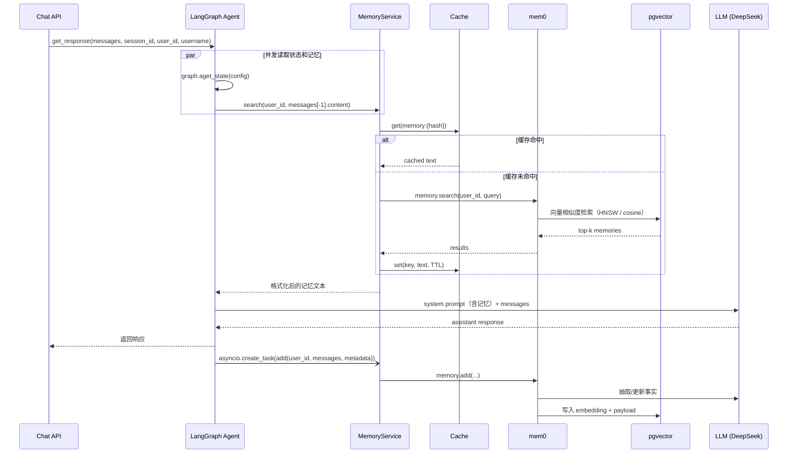

# 长期记忆实现详解（mem0 + pgvector）

> 适用代码：当前 `master`。行号以当前提交为准。
>
> 相关文档：[docs/memory.md](memory.md)（上游设计概览）、[docs/local-run-deepseek-siliconflow.md](local-run-deepseek-siliconflow.md)（本机启动手册）。

## 1. 一句话总结

项目用 **mem0 + pgvector** 实现按用户隔离的语义长期记忆：

- **请求前**：用最后一条用户消息做向量检索，把命中结果注入 system prompt。
- **响应后**：把本轮消息交给 mem0，由 memory LLM 抽取事实、embedding 后写入 pgvector。
- **缓存**：检索结果可走 Valkey/Redis 或进程内 TTL 缓存。

应用层不直接操作向量库，只负责 `search` / `add` / 缓存 / prompt 注入；向量检索、事实抽取、去重更新都由 mem0 完成。

---

## 2. 组件

| 组件 | 位置 | 作用 |
|---|---|---|
| `MemoryService` | `app/services/memory.py` | mem0 配置、search/add、缓存 |
| mem0 `AsyncMemory` | 依赖 `mem0ai` | 事实抽取、embedding、向量存储 |
| pgvector | PostgreSQL 扩展 | 存储向量和 payload |
| `OpenAICompatibleEmbedding` | `app/services/embeddings.py` | 兼容硅基等不接受 `dimensions` 的 embedder |
| `CacheService` | `app/core/cache.py` | 检索结果缓存 |
| `GraphState.long_term_memory` | `app/schemas/graph.py` | 把检索结果传给 LangGraph |
| `system.md` | `app/core/prompts/system.md` | 把记忆拼进 system prompt |

---

## 3. 请求时序



---

## 4. 检索路径

### 4.1 入口

聊天接口调用 `agent.get_response(...)` / `get_stream_response(...)`：

- 普通聊天：`app/core/langgraph/graph.py:312`
- 流式聊天：`app/core/langgraph/graph.py:383`

两处都用 `asyncio.gather` 并发执行：

```python
state, relevant_memory = await asyncio.gather(
    graph.aget_state(config),
    memory_service.search(user_id, messages[-1].content),
)
```

并发执行是为了节省 200–500ms。

注意：**检索 query 只取最后一条消息** `messages[-1].content`，不是整段对话。

### 4.2 `MemoryService.search()`

实现在 `app/services/memory.py:74`。

1. `user_id` 为空 → 直接返回空字符串。
   - 匿名会话不写不查，避免所有匿名用户共享一个记忆分区。
2. 计算缓存 key 并查缓存。
3. 缓存未命中 → 调用 mem0：

   ```python
   results = await memory.search(user_id=str(user_id), query=query)
   ```

4. 格式化结果：

   ```python
   result = "\n".join([f"* {r['memory']}" for r in results["results"]])
   ```

5. 只有**非空成功结果**才写缓存。
6. 任何异常都会记录 `failed_to_get_relevant_memory`，返回空字符串，聊天继续。

### 4.3 注入 system prompt

检索结果作为 `GraphState.long_term_memory` 传入图：

- 状态字段：`app/schemas/graph.py:18`
- 注入点：`app/core/langgraph/graph.py:150`

```python
SYSTEM_PROMPT = load_system_prompt(
    username=username,
    long_term_memory=state.long_term_memory,
)
```

模板位置：`app/core/prompts/system.md:11`

```markdown
# What you know about the user
{long_term_memory}
```

没有检索到记忆时，传入 `"No relevant memory found."`，保证占位符始终有值。

---

## 5. 写入路径

### 5.1 触发时机

图执行完成后，把消息转成 OpenAI 格式，并创建后台任务：

```python
openai_msgs = convert_to_openai_messages(response["messages"])
asyncio.create_task(
    memory_service.add(user_id, openai_msgs, config.get("metadata"))
)
```

- 普通聊天：`app/core/langgraph/graph.py:338`
- 流式聊天：`app/core/langgraph/graph.py:415`

`asyncio.create_task` 意味着：

- 响应立即返回，不等待 mem0 完成。
- 写入失败只记录日志，不影响聊天。
- 进程立即退出时，未完成的后台写入可能丢失。

### 5.2 写入内容

- 传入的是该 thread 的**完整消息历史**（`response["messages"]` / `state.values["messages"]`），不只是最后一条用户消息。
- mem0 会根据 hash、LLM 判断来新增、更新或删除记忆，避免简单重复。
- `metadata` 来自 LangGraph 配置，包含 `user_id`、`username`、`session_id`、`environment`、`debug` 等。

### 5.3 中断场景

如果图被 HITL（`ask_human`）中断：

- 普通聊天在 `app/core/langgraph/graph.py:332` 检测到 `state.next` 后提前返回，不会写入记忆。
- 流式聊天在 `app/core/langgraph/graph.py:409` 类似。
- 用户回复后图恢复并完成，才会走正常的后台写入。

---

## 6. 存储结构

mem0 在应用所用的 PostgreSQL 库中自动建表：

```text
longterm_memory
  id      uuid
  vector  vector(1024)
  payload jsonb
  primary key (id)
  hnsw index vector_cosine_ops

mem0migrations
  mem0 自己的 schema 版本表
```

实际 payload 示例：

```json
{
  "data": "Likes green tea",
  "hash": "6be668ba991c1e5e20a76c7bb1ac49aa",
  "user_id": "3",
  "username": "alice",
  "thread_id": "876e3698-...",
  "session_id": "876e3698-...",
  "environment": "development",
  "debug": true,
  "created_at": "2026-10-19T19:37:49.924391-07:00"
}
```

关键点：

- 向量维度由 `LONG_TERM_MEMORY_EMBEDDER_DIMS` 决定，当前是 **1024**。
- 索引是 HNSW + cosine 距离。
- 记忆按 `user_id` 隔离；同一用户的多个 session 共享长期记忆。
- 这些表由 mem0 管理，不由 Alembic 管理；`alembic/env.py:37` 的 `EXCLUDE_TABLES` 明确排除了 `longterm_memory` 和 `mem0migrations`。

---

## 7. 缓存层

实现在 `app/core/cache.py`。

### 7.1 后端选择

`app/core/cache.py:177`：

- 配置了 `VALKEY_HOST` 且安装了 `redis` 可选依赖 → `ValkeyCacheService`。
- 否则 → `InMemoryCacheService`（进程内 TTL 缓存）。

当前项目没有安装 `cache` extra，所以日志里会看到 `redis_not_available`，使用内存缓存。

如果要多实例共享缓存：

```bash
uv sync --extra cache
```

然后设置：

```env
VALKEY_HOST=localhost
VALKEY_PORT=6380
```

### 7.2 key 与 TTL

`cache_key()` 在 `app/core/cache.py:197`：

```python
raw = ":".join(parts)
hashed = hashlib.sha256(raw.encode()).hexdigest()[:16]
return f"{prefix}:{hashed}"
```

`MemoryService.search()` 调用：

```python
key = cache_key("memory", str(user_id), query)
```

所以实际 key 是：

```text
memory:{sha256("user_id:query")[:16]}
```

注意：`docs/memory.md` 里写的是 `memory:{user_id}:{sha256(query)[:16]}`，与当前代码略有出入，以代码为准。

TTL 由 `CACHE_TTL_SECONDS` 控制，默认 60 秒。只缓存成功的非空结果，错误不缓存。

---

## 8. 当前配置（DeepSeek + SiliconFlow）

配置读取位置：`app/core/config.py:165`。

| 变量 | 当前值 | 作用 |
|---|---|---|
| `LONG_TERM_MEMORY_COLLECTION_NAME` | `longterm_memory` | pgvector 表名 |
| `LONG_TERM_MEMORY_MODEL` | `deepseek-chat` | mem0 抽取事实/更新记忆用的 LLM |
| `LONG_TERM_MEMORY_LLM_BASE_URL` | `https://api.deepseek.com/v1` | 记忆 LLM 地址 |
| `LONG_TERM_MEMORY_LLM_API_KEY` | `<DeepSeek key>` | 不写进文档 |
| `LONG_TERM_MEMORY_EMBEDDER_PROVIDER` | `openai_compatible` | 使用省略 `dimensions` 的兼容 embedder |
| `LONG_TERM_MEMORY_EMBEDDER_MODEL` | `BAAI/bge-m3` | 向量模型 |
| `LONG_TERM_MEMORY_EMBEDDER_BASE_URL` | `https://api.siliconflow.cn/v1` | 向量模型地址 |
| `LONG_TERM_MEMORY_EMBEDDER_API_KEY` | `<SiliconFlow key>` | 不写进文档 |
| `LONG_TERM_MEMORY_EMBEDDER_DIMS` | `1024` | 必须与 pgvector 表维度一致 |
| `CACHE_TTL_SECONDS` | `60` | 检索缓存 TTL |
| `VALKEY_HOST` | 空 | 使用进程内缓存 |

代码里的默认值仍是 `gpt-5-nano` / `text-embedding-3-small`，当前 `.env.development` 覆盖成了 DeepSeek + SiliconFlow。

### 8.1 为什么需要自定义 embedder

硅基流动的 embedding API：

- `BAAI/bge-m3` 原生输出 1024 维。
- 不接受 OpenAI SDK 的 `dimensions` 参数。
- mem0 的 `OpenAIEmbedding` 会强制传 `dimensions=self.config.embedding_dims`，导致 400。

因此：

- `app/services/embeddings.py` 提供 `OpenAICompatibleEmbedding`，省略 `dimensions`。
- `app/services/memory.py:17` 在 `LONG_TERM_MEMORY_EMBEDDER_PROVIDER=openai_compatible` 时，把 mem0 的 `openai` provider 替换成这个类。
- pgvector 表仍然按 `LONG_TERM_MEMORY_EMBEDDER_DIMS=1024` 建。

### 8.2 维度变化

如果更换 embedding 模型导致维度变化，需要删除旧表让 mem0 重建：

```sql
DROP TABLE IF EXISTS longterm_memory;
DROP TABLE IF EXISTS mem0migrations;
```

然后重启应用。**这会删除已有长期记忆。**

---

## 9. 启动预热

`app/main.py:65` 的 lifespan：

```python
try:
    await memory_service.initialize()
except Exception as e:
    logger.exception("memory_service_pre_warm_failed", error=str(e))
```

`initialize()` 会创建 `AsyncMemory`、pgvector 连接池并执行 schema 检查，避免第一次检索/写入的冷启动开销。

失败只记录日志，不会阻止应用启动；后续记忆功能会降级（检索返回空、写入失败）。

---

## 10. 文件地图

| 文件 | 内容 |
|---|---|
| `app/services/memory.py:28` | mem0 `AsyncMemory.from_config`：pgvector / LLM / embedder |
| `app/services/memory.py:74` | `search()`：缓存 + mem0 检索 + 格式化 |
| `app/services/memory.py:106` | `add()`：后台写入 + 异常处理 |
| `app/services/embeddings.py` | 硅基兼容 embedder |
| `app/core/langgraph/graph.py:312` | 普通聊天：并发检索 + 注入 + 后台写入 |
| `app/core/langgraph/graph.py:383` | 流式聊天：同上 |
| `app/core/langgraph/graph.py:150` | 把记忆注入 system prompt |
| `app/schemas/graph.py:18` | `GraphState.long_term_memory` |
| `app/core/prompts/system.md:11` | `{long_term_memory}` 占位符 |
| `app/core/cache.py:177` | 缓存后端选择 |
| `app/core/cache.py:197` | 缓存 key 生成 |
| `app/core/config.py:165` | `LONG_TERM_MEMORY_*` 配置 |
| `app/main.py:65` | 启动预热 |
| `alembic/env.py:37` | 排除 mem0 / pgvector 表 |

---

## 11. 验证方法

### 11.1 查看数据库

```bash
docker exec fastapi_langgraph_template-postgres-1 \
  psql -U postgres -d fastapi_agent -c "\d longterm_memory"

docker exec fastapi_langgraph_template-postgres-1 \
  psql -U postgres -d fastapi_agent \
  -c "select payload->>'data', payload->>'user_id' from longterm_memory;"
```

### 11.2 跨会话召回

参考 [local-run-deepseek-siliconflow.md](local-run-deepseek-siliconflow.md) 的 7.8 节：

1. 会话 A 告诉 agent："我叫 Alice，我喜欢绿茶。"
2. 等待约 10 秒，让后台 mem0 写入完成。
3. 同一个用户创建会话 B，问："我喜欢喝什么？"
4. 正常应回答 "绿茶 / green tea"。

### 11.3 日志事件

```text
memory_search_cache_hit
long_term_memory_updated_successfully
failed_to_get_relevant_memory
failed_to_update_long_term_memory
memory_service_initialized
memory_service_pre_warm_failed
```

---

## 12. 设计取舍与注意事项

1. **检索只取最后一条消息**：多轮对话中，如果最后一条不是用户消息，query 可能不是预期内容。
2. **写入是 fire-and-forget**：响应快，但进程退出或崩溃时可能丢写。
3. **写入的是完整 thread 历史**：mem0 自己做 hash/LLM 去重，但每轮都会把历史交给 memory LLM，长对话成本会上升。
4. **记忆按 user_id 隔离**：同一用户跨会话共享；匿名 `user_id=None` 直接跳过。
5. **缓存是近似的**：key 包含完整 query，语义相近但措辞不同的问法会各缓存一份；TTL 默认 60 秒。
6. **多实例部署**：内存缓存只在单进程内有效；多实例应启用 Valkey/Redis。
7. **记忆依赖 LLM**：事实抽取失败时，聊天不受影响，但记忆不会更新。
8. **schema 由 mem0 管理**：Alembic 不管理 `longterm_memory` / `mem0migrations`；维度变更需要手动删表重建。
9. **prompt 注入风险**：记忆内容会进入 system prompt。如果未来支持不可信用户内容或多租户，需要评估提示词注入风险。
10. **文档差异**：`docs/memory.md` 的缓存 key 格式与当前代码不一致，以本文和 `app/core/cache.py` 为准。
